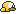
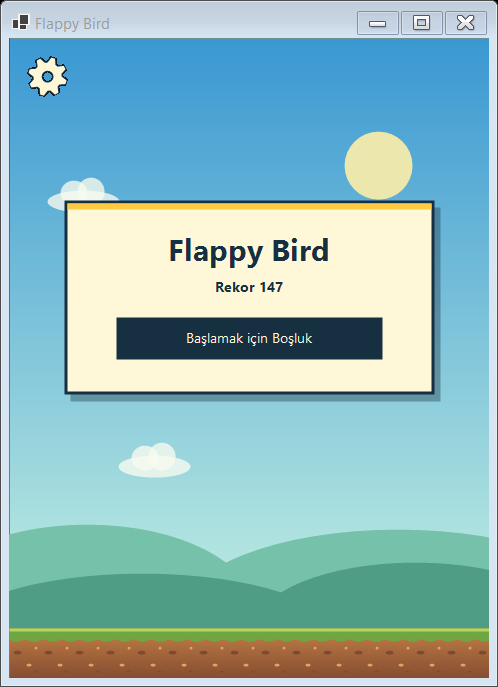
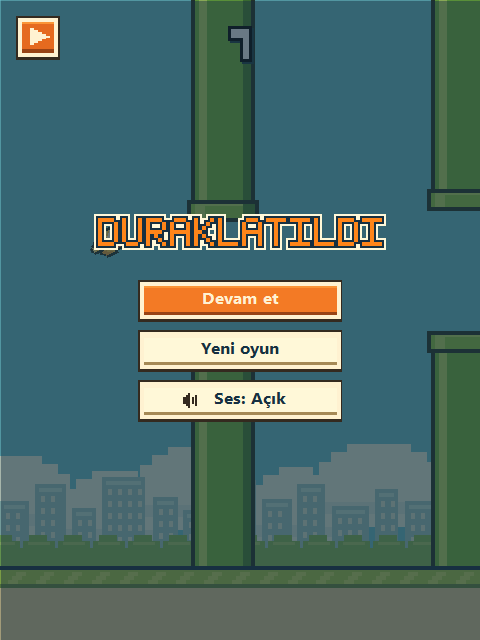
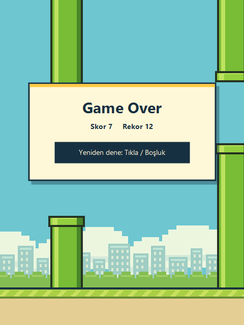

#  Flappy Bird

Boşluk tuşuyla veya oyun alanına sol tıklayarak zıplayıp boruların arasından geçtiğiniz bir Windows Forms oyunu. Her geçilen boru çifti bir puan kazandırır. Boruya veya zemine çarpınca oyun durur.

## Teknolojiler

- C# ve .NET 10
- Windows Forms ve `System.Windows.Forms.Timer`

## Kurulum ve çalıştırma

Windows ve .NET 10 SDK gerekir. Depoyu yerel olarak açıp kök klasörde şu komutları çalıştırın:

```powershell
dotnet build FlappyBird.slnx
dotnet run --project FlappyBird/FlappyBird.csproj
```

`FlappyBird.slnx` dosyasını .NET 10 destekleyen Visual Studio ile de açabilirsiniz.

## Kontroller ve oyun kuralları

- **Boşluk / Sol tık:** **HAZIR OL** ekranında ilk sıçramayı yapıp turu başlatır. Tur sırasında kuşu yukarı iter. Fareyle oynamak için oyun alanına tıklayın.
- **Tekrar oyna:** Game Over ekranı tur skorunu ve rekoru gösterir. Kısa bekleme ve çarpışma sesi tamamlandıktan sonra turuncu düğmeye veya oyun alanına tıklayın ya da Boşluk tuşuna basın. Ses kapalıysa bekleme 300 ms sürer.
- Başlangıçta kuş ortadan normal oyun hizasına kayar. Kuş hizaya ulaştığında ilk boru sağ kenardan görünür. İki boru çifti sağdan sola ilerler. Boru açıklığı 120 oyun pikselidir. Açıklığın dikey konumu ve boru çiftleri arasındaki yatay mesafe rastgele belirlenir. Ekrandan çıkan çift sağda yeni bir konumda belirir.
- **Esc / Duraklatma düğmesi:** Aktif turu duraklatır veya kaldığı yerden sürdürür. Sol üstteki turuncu düğme fareyle aynı işlevi görür. Menüdeki **Devam et** turu sürdürür, **Yeni oyun** ise skoru sıfırlayıp başlangıç ekranına döner.
- **Ses: Açık / Kapalı:** Duraklatma menüsünden kanat çırpma, puan ve çarpışma efektlerini bu oturum için açıp kapatır.

Pencere oyun alanının 3:4 oranını koruyarak kenardan veya köşeden yeniden boyutlandırılabilir. Büyüt düğmesi pencereyi monitörün kullanılabilir alanına sığan en büyük boyuta getirir. Düğmeye tekrar basarak önceki boyuta dönebilirsiniz. Minimum oyun alanı 480 × 640 pikseldir.

## Tasarım ve sınırlamalar

`GameState` hareket, çarpışma, engeller ve skoru yönetir. Windows Forms klavye ve fare girişini alır, zamanlayıcıyla oyun durumunu günceller. `ArcadeRenderer` oyun sahnesini ve arayüzü çizer. Çarpışma sınır dikdörtgenleriyle hesaplanır. Tur skoru her yeni oyunda sıfırlanır. Rekor, tur sonunda yükselirse Windows kullanıcı profilindeki `%LOCALAPPDATA%/FlappyBird/high-score.txt` dosyasına kaydedilir. Kayıt sorunu varsa oyun devam eder ve arayüzde durum gösterilir.

Üst ortadaki sayaç, geçilen boru çiftlerini siyah konturlu beyaz rakamlarla gösterir. Arka plan kodla çizilir. Kuş, borular ve zemin gömülü PNG varlıklarını kullanır. Pencere ve görev çubuğunda kuş simgesi görünür.

`GameAudio` gömülü WAV efektlerini yönetir. Puan ve çarpışma efektleri ayrı oynatma akışları kullandığı için diğer seslerle birlikte duyulabilir.

Ses efektleri, Dong Nguyen ve .GEARS Studios’un Flappy Bird Android v1.3 sürümünden arşivlenen dosyalardan WAV biçimine dönüştürüldü. [Ses arşivi](https://github.com/FlappyBirdRestored/flappybird-restored/tree/restored/apktool_source/assets/sounds)

## Ekran görüntüleri

**Başlangıç**



**Oyun sırasında**


**Duraklatma menüsü**



**Çarpışma sonrası**


