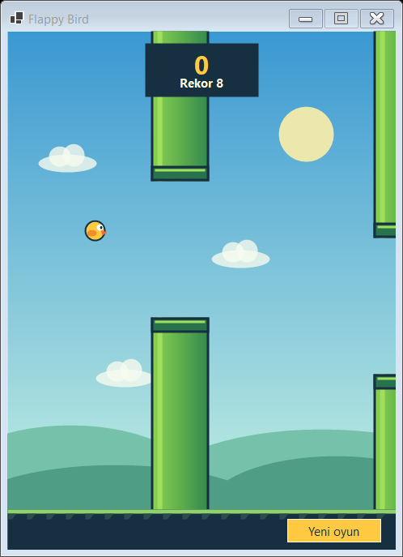

# Flappy Bird

Boşluk tuşuyla veya oyun alanına sol tıklayarak zıplayıp boruların arasından geçtiğiniz bir Windows Forms oyunu. Her geçilen boru çifti bir puan kazandırır. Boruya veya zemine çarpınca oyun durur.

## Teknolojiler

- C# ve .NET 10
- Windows Forms ve `System.Windows.Forms.Timer`

## Kurulum ve çalıştırma

Windows ve .NET 10 SDK gerekir. Depoyu yerel olarak açıp kök klasörde şu komutları çalıştırın:

```powershell
dotnet build FlappyBird.slnx
dotnet run --project FlappyBird/FlappyBird.csproj
```

`FlappyBird.slnx` dosyasını .NET 10 destekleyen Visual Studio ile de açabilirsiniz.

## Kontroller ve oyun kuralları

- **Boşluk / Sol tık:** Oyunu başlatır veya kuşu yukarı iter. Game Over ekranında yeni turu başlatır. Fareyle oynamak için oyun alanına tıklayın.
- İki boru çifti sağdan sola ilerler. Ekrandan çıkan çift sağ tarafta yeni bir açıklıkla tekrar belirir.
- **Çark → Yeni oyun:** Sol üst köşedeki oyun menüsünden oyun durumunu ve skoru sıfırlar. Yeni turu Boşluk tuşuyla veya oyun alanına sol tıklayarak başlatabilirsiniz.

Pencere oyun alanının 3:4 oranını koruyarak kenardan veya köşeden yeniden boyutlandırılabilir. Büyüt düğmesi pencereyi monitörün kullanılabilir alanına sığan en büyük boyuta getirir. Düğmeye tekrar basarak önceki boyuta dönebilirsiniz. Minimum oyun alanı 480 × 640 pikseldir.

## Tasarım ve sınırlamalar

`GameState` hareket, çarpışma, engeller ve skoru yönetir. Form klavye olaylarını alır, zamanlayıcıyla oyun durumunu günceller ve ekrana çizer. Çarpışma sınır dikdörtgenleriyle hesaplanır. Tur skoru her yeni oyunda sıfırlanır. Rekor, tur sonunda yükselirse Windows kullanıcı profilindeki `%LOCALAPPDATA%/FlappyBird/high-score.txt` dosyasına kaydedilir. Kayıt sorunu varsa oyun devam eder ve arayüzde durum gösterilir.

## Ekran görüntüleri

**Başlangıç**


**Oyun sırasında**



**Çarpışma sonrası**


